<h1 align="center">
   
  
   
  Granthālaya
   
</h1>

<h4 align="center">A daily newspaper that shows the evidence behind every story, and a library that reads like paper.</h4>

  
  
  

  <a href="#-what-it-does">What it does</a> •
  <a href="#-get-started">Get started</a> •
  <a href="#-how-it-works">How it works</a> •
  <a href="#-your-data">Your data</a> •
  <a href="#-faq-and-troubleshooting">FAQ</a> •
  <a href="#%EF%B8%8F-for-developers">For developers</a>

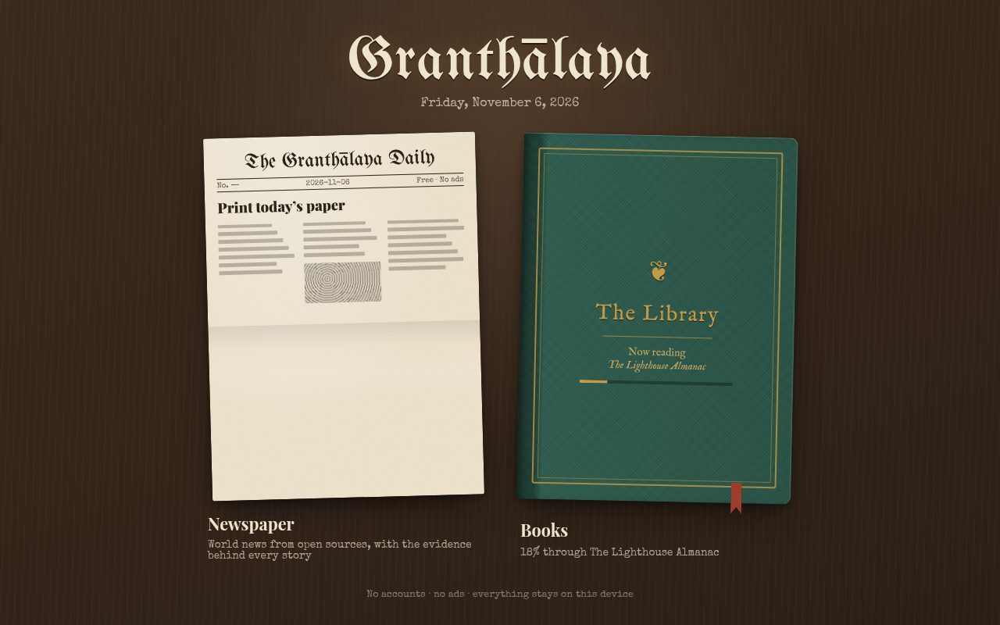

Granthālaya (ग्रन्थालय, "library") is a reader with two cards on an old wooden desk. The
**Newspaper** prints a fresh paper each day from open, public news sources and shows how well
each story is sourced. The **Library** keeps your books on a shelf and shows them on calm,
paper-like pages. Status: **early (0.2)**. Desktop builds are not code-signed yet, so your
system warns you on first launch (Step 2 says what to click).

## ✨ What it does

- 📰 **A real daily paper** – one edition a day, page by page like a broadsheet, with a front
  page, sections and a last page that says what was left out and why.
- ⚖️ **Evidence, not a label** – every story gets a score out of 100 made of five checks you
  can read: independent newsrooms, loaded words, attributed claims, owners named in the story,
  and owners on public record.
- 🗄️ **Every past paper, searchable** – the **Archive** keeps each edition you printed. Search
  every story in them by a name, a place or a word.
- 📚 **Most book formats** – EPUB, PDF, MOBI and AZW3 (Kindle files without copy protection),
  FB2 and comic archives (CBZ), all on one shelf.
- 🖍️ **Highlights and notes** – select text, pick one of four colours, add a note. Save them all
  as a Markdown file (plain text any notes app opens) with the whole passage, never cut short.
- 🔎 **Find anything** – search inside the open book, filter your shelf, or browse online book
  catalogues (OPDS, a common format for book catalogues), with a login if one needs it.
- 🕯️ **Pages that rest your eyes** – warm grey paper (never pure white), soft ink, book fonts,
  lines kept to a comfortable length, and two-page spreads on wide screens.
- 💬 **Settings that tune themselves** – now and then it asks one quick question ("Is the text
  too small?") and adjusts for that device and time of day.

## 📸 Screenshots

<table>
  <tr>
    <td>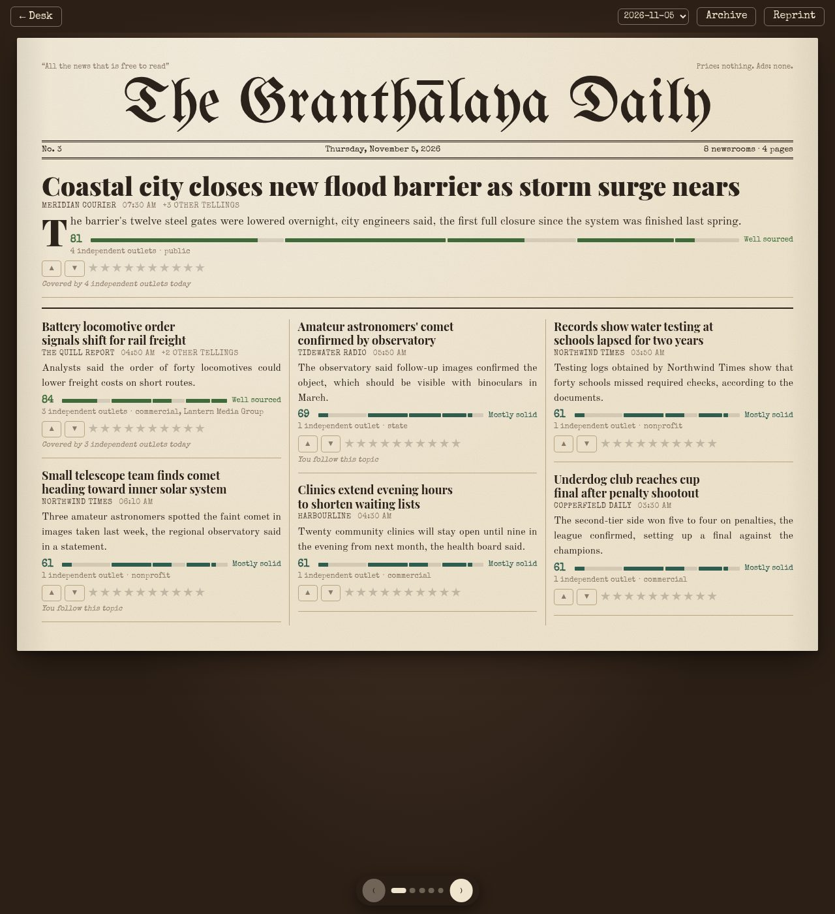</td>
    <td>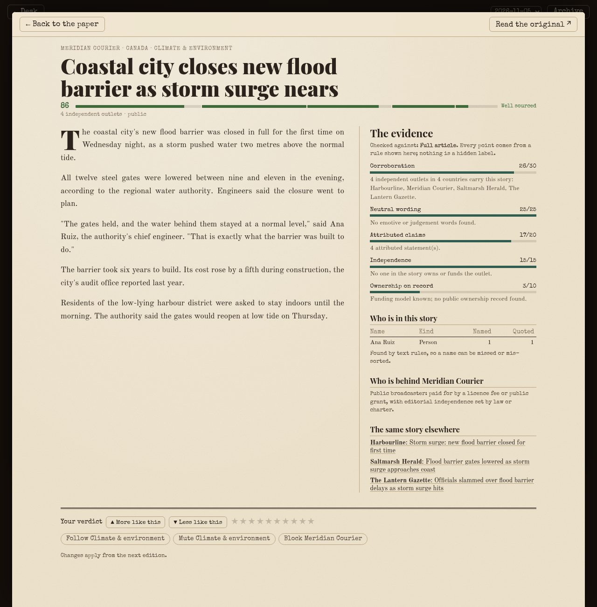</td>
    <td>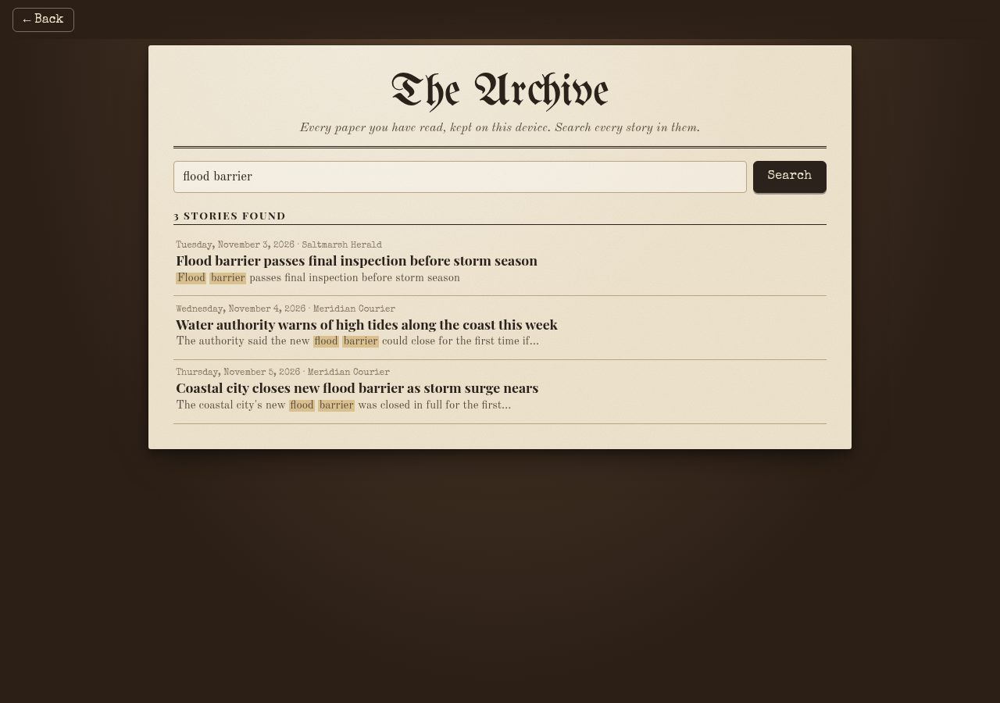</td>
  </tr>
  <tr>
    <td align="center">Today's paper</td>
    <td align="center">The evidence behind a story</td>
    <td align="center">Search every past paper</td>
  </tr>
  <tr>
    <td>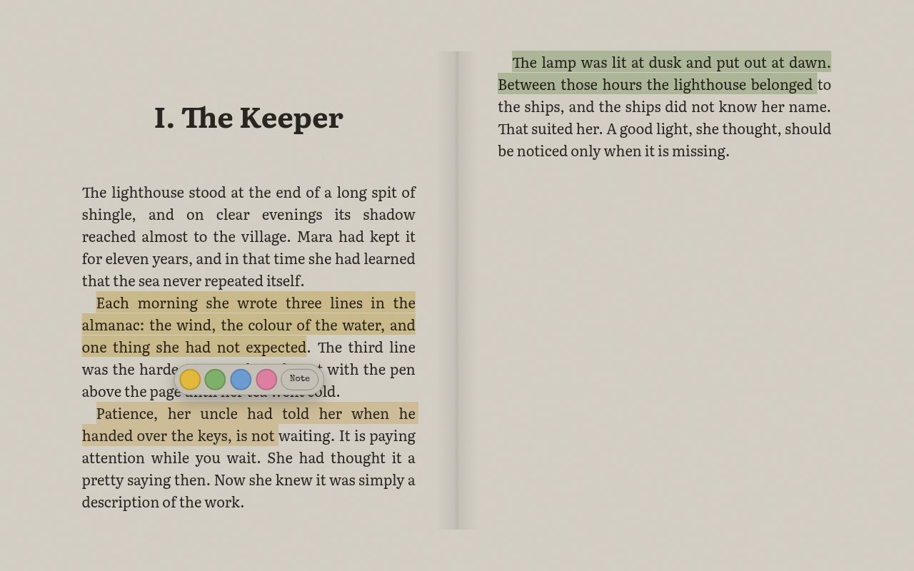</td>
    <td>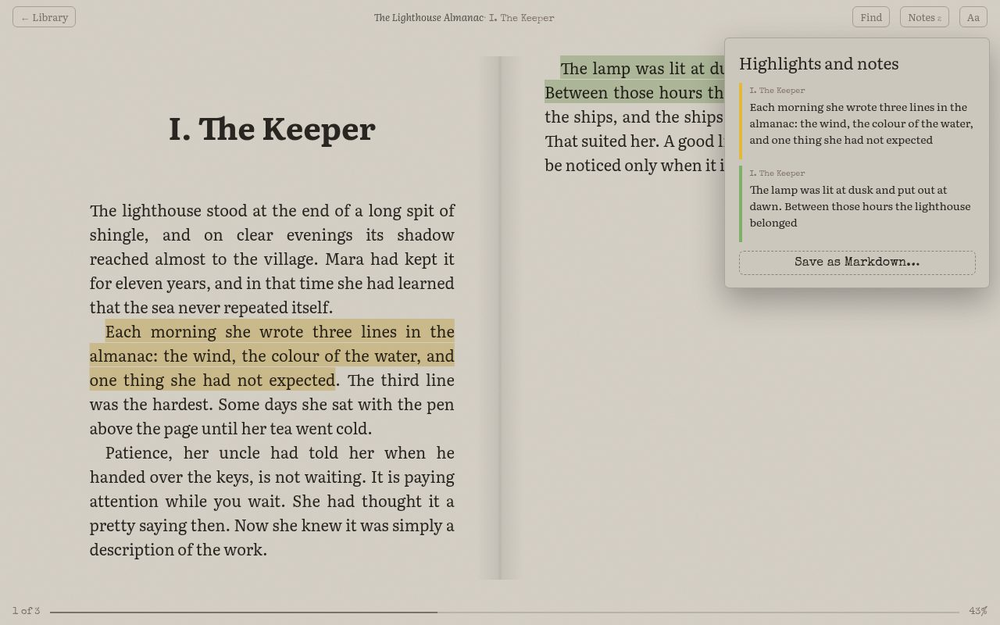</td>
    <td>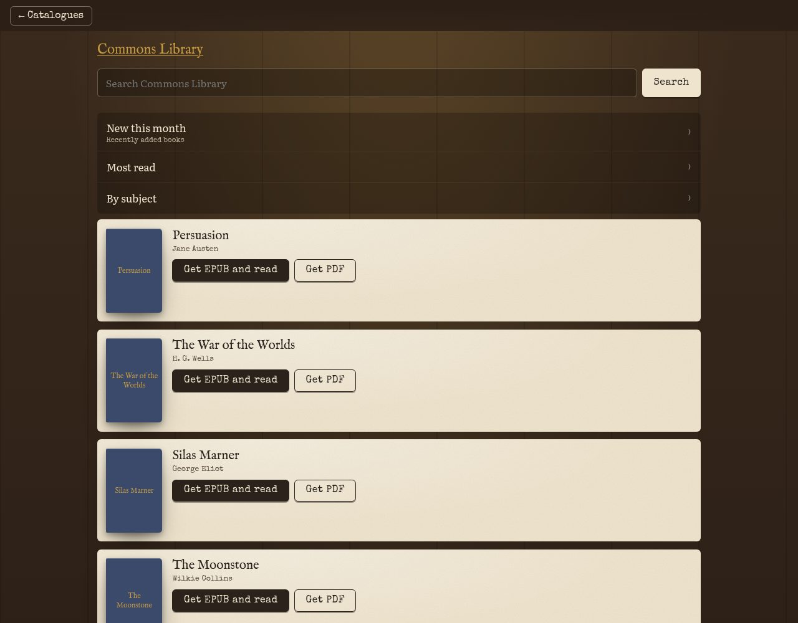</td>
  </tr>
  <tr>
    <td align="center">Highlight as you read</td>
    <td align="center">Your notes, ready to save</td>
    <td align="center">Online book catalogues</td>
  </tr>
  <tr>
    <td>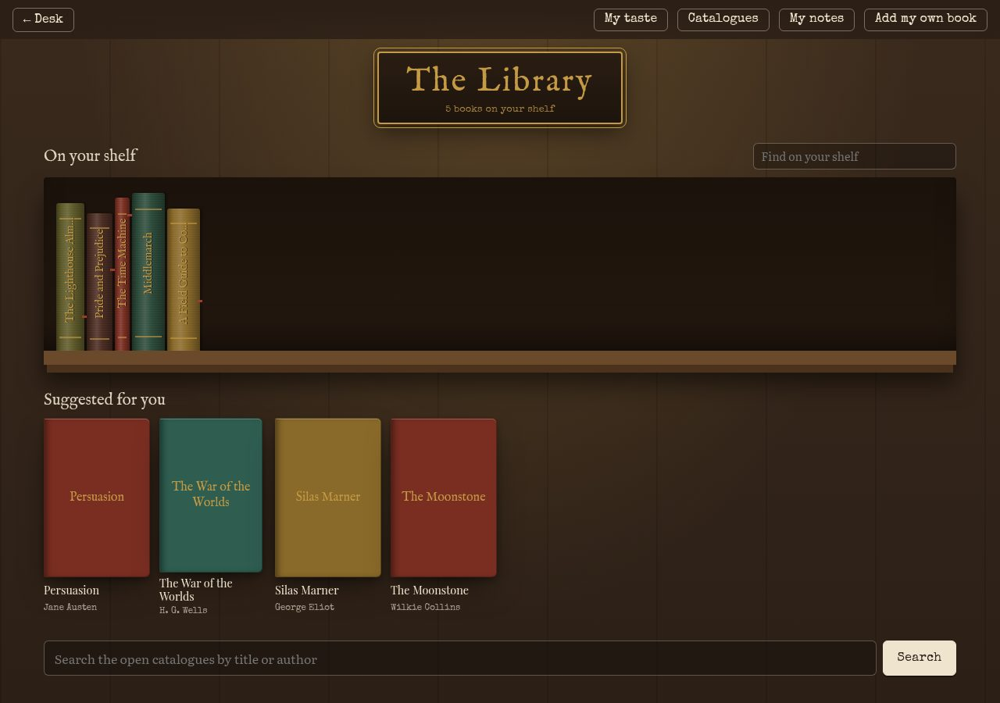</td>
    <td>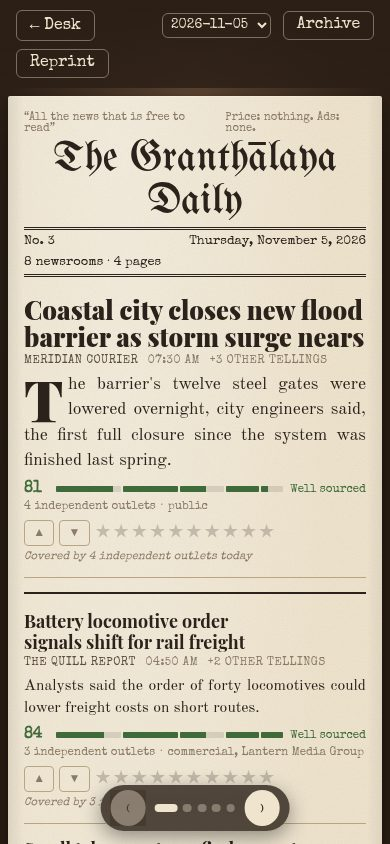</td>
    <td>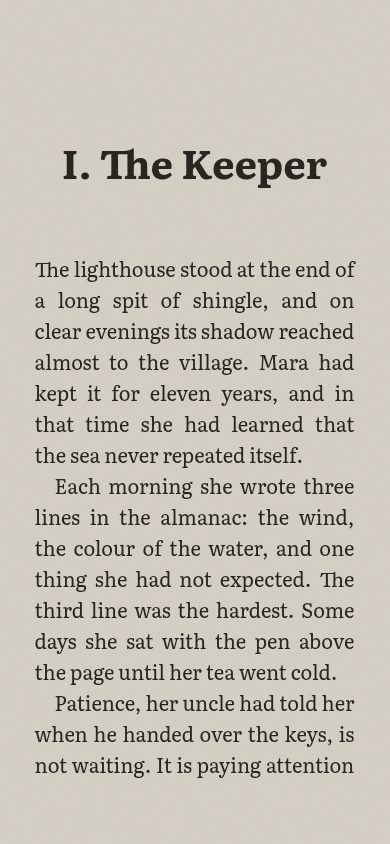</td>
  </tr>
  <tr>
    <td align="center">Your shelf</td>
    <td align="center">The paper on a phone</td>
    <td align="center">A book on a phone</td>
  </tr>
</table>

The screenshots use made-up newsrooms, stories and a made-up book.

## 🚀 Get started

### Step 1: Download

Open the [releases page](https://github.com/sudharamachandranrajeev/granthalaya/releases) and
pick the file for your device:

| Platform | File to pick | Works on |
| --- | --- | --- |
| Windows | `Granthalaya_…_x64-setup.exe` (or the `.msi`) | Windows 10 or 11 |
| macOS | `Granthalaya_…_aarch64.dmg` | Apple Silicon Macs (M1 or newer) |
| Linux | `Granthalaya_…_amd64.AppImage`, or the `.deb` for Debian and Ubuntu | most 64-bit distributions |
| Android | `Granthalaya_…_aarch64.apk` | Android 7.0 or newer, 64-bit phones |

> [!NOTE]
> Until the first release appears there, build it yourself (see **For developers** below).

### Step 2: Install

<b>Windows</b>

1. Double-click the `-setup.exe` file.
2. Windows may say "Windows protected your PC". The app is not code-signed yet, so Windows does
   not know it. Click **More info**, then **Run anyway**.
3. Follow the installer. Granthālaya is then in the Start menu.

<b>macOS</b>

1. Open the `.dmg` and drag **Granthalaya** into **Applications**.
2. The first time, macOS says it cannot check the app, because it is not signed yet.
3. Open **System Settings → Privacy & Security**, scroll down and click **Open Anyway**.

<b>Linux</b>

- **AppImage:** right-click the file → **Properties** → allow it to run as a program. Then
  double-click it. Or in a terminal: `chmod +x Granthalaya_*.AppImage && ./Granthalaya_*.AppImage`.
- **.deb:** `sudo apt install ./Granthalaya_*_amd64.deb`, then open it from your app menu.

<b>Android</b>

1. Download the `.apk` on your phone and open it.
2. Android asks to allow installs from your browser or file app. Allow it for this one file.
3. Tap **Install**.

### Step 3: Print your first paper

1. Click the **Newspaper** card.
2. Pick a few subjects you care about, then click **Print my paper**.
3. Wait a few seconds while it reads the newsrooms and lays out the pages.
4. Turn pages with the arrows, the dots at the bottom, the arrow keys or a swipe.
5. Click a headline to read the full story and **The evidence** behind its score.
6. Click **Archive** to see and search every paper you printed before.

### Step 4: Fill your shelf

1. Click the **Books** card and answer the library card (genres, favourite authors, length).
2. Click a suggested book, then **Add and read**. Or click **Add my own book** to add a file.
3. Click the sides of the page to turn it. **Aa** opens the comfort settings.
4. Select some text to highlight it. **Notes** lists them, and **Save as Markdown…** saves them.
5. **Find** (or Ctrl+F) searches the book you are reading.

### Optional: add an online book catalogue

1. In the Library, click **Catalogues**.
2. Pick a suggested catalogue, or click **Add a catalogue** and paste its address.
3. If the catalogue needs a login, tick **This catalogue needs a login** and enter it. The password goes in
   your system's password store, or in the app's private storage on Android.
4. Browse or search it, then click **Get EPUB and read**.

## 🧭 How it works

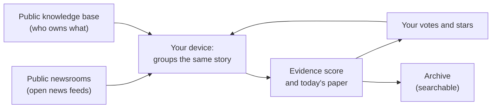

- It reads the open news feeds of about twenty public broadcasters and non-profit or
  independent newsrooms. The full list, with each one's funding model, is in
  [`core/data/sources.json`](core/data/sources.json).
- Stories about the same event are grouped, so you see how many newsrooms carry it.
- The score is plain rules you can read in the app. It never says "left" or "right".
- Your votes train a small model on your device. Nothing is sent anywhere.

## 🔒 Your data

- Everything stays on your device: papers, votes, books, highlights and reading settings.
- There are no accounts, no ads and no tracking.
- The app contacts only the news feeds, the public knowledge base for owner facts, the book
  catalogues you use, and a story's own page when you open it.
- Catalogue passwords are kept in your system's password store (on Android, in the app's
  private storage), never in the library file.
- On Linux the data lives in `~/.local/share/dev.granthalaya.app/`. Delete that folder to start
  again.

> [!IMPORTANT]
> Removing a book keeps its highlights. Deleting the data folder removes everything, highlights
> included. Save your notes as Markdown first if you want to keep them.

## ❓ FAQ and troubleshooting

<b>Is the score a verdict on whether a story is true?</b>

No. It measures how well a story is sourced: who else reports it, how it words things and who
owns the newsroom. Read **The evidence** under any story to see each part.

<b>The last page says "Could not reach" a newsroom</b>

A feed did not answer within 12 seconds. The paper prints without it and says so. Click
**Reprint** later to try again.

<b>A catalogue says it "asks for a login" or "did not accept this login"</b>

Open **Catalogues**, click **Settings** next to it, tick **This catalogue needs a login** and check the user
name and password. Leave the password empty to keep the saved one.

<b>I cannot highlight in a PDF or comic</b>

Not yet. PDFs and comics are pictures of pages, so highlights work only in EPUB, MOBI, AZW3 and
FB2 books for now.

<b>A Kindle book will not open</b>

Books bought from a store are often copy-protected (DRM). Granthālaya opens only files without
copy protection.

<b>The reader asks me questions about the text</b>

That is how it tunes itself. It asks at most once a session. Click **Not now** to skip. Every
change it made is listed under **Aa**.

## 🛠️ For developers

Build, test, screenshots and project layout

- **Build:** install [Rust](https://www.rust-lang.org/tools/install),
  [Node.js 20 or newer](https://nodejs.org) and the
  [system libraries for Tauri](https://v2.tauri.app/start/prerequisites/). Then:
  `cd app && npm install && npx tauri build`. Bundles land in `target/release/bundle/`.
- `core/` – the Rust library: feeds, story grouping, the evidence score, the learner, book and
  OPDS catalogues, highlights, the archive search and the comfort settings. Test it with
  `cargo test -p granthalaya-core`.
- `core/examples/live.rs` builds a real paper from the live feeds:
  `cargo run -p granthalaya-core --example live`.
- `app/` – the Tauri 2 shell and the Svelte 5 interface. `npm run check` type-checks it, and
  `npx tauri dev` runs it with live reload. The book reader is
  [foliate-js](https://github.com/johnfactotum/foliate-js) (MIT), kept in `app/public/foliate-js`.
- **Android:** `npx tauri android build --debug --apk` (needs the Android SDK and NDK, and Java
  17 to 21: point `JAVA_HOME` at it if your system Java is newer, or the build stops with
  "Unsupported class file major version").
- **Screenshots:** `scripts/screenshots.sh` renders `docs/screenshots/` from made-up data
  (`core/examples/demo.rs`) in headless Chromium.
- **Before publishing:** `scripts/check-public.sh` scans for secrets and personal details.
- **Releases:** pushing a `v*` tag runs `.github/workflows/release.yml` and makes a draft
  release. See [CHANGELOG.md](CHANGELOG.md).

## License

[MIT](LICENSE). Fonts are under the SIL Open Font License. foliate-js is MIT
([its licence](app/public/foliate-js/LICENSE)).

> GitHub [@sudharamachandranrajeev](https://github.com/sudharamachandranrajeev)
