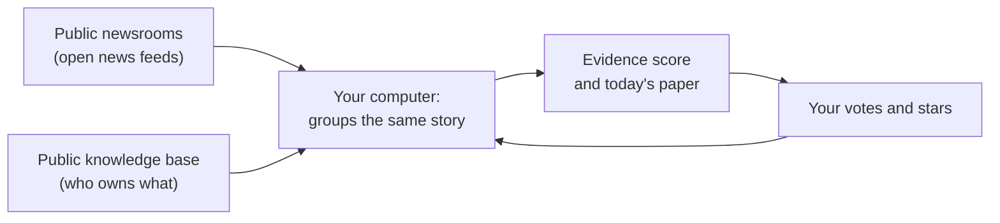

<h1 align="center">
  <br>
  <a href="https://github.com/sudharamachandranrajeev/granthalaya"></a>
  <br>
  Granthālaya
  <br>
</h1>

<h4 align="center">A daily newspaper that shows the evidence behind every story, and a library that reads like paper.</h4>

<p align="center">
  
  
  <a href="LICENSE"></a>
</p>

<p align="center">
  <a href="#-what-it-does">What it does</a> •
  <a href="#-get-started">Get started</a> •
  <a href="#-how-it-works">How it works</a> •
  <a href="#-your-data">Your data</a> •
  <a href="#-faq-and-troubleshooting">FAQ</a> •
  <a href="#%EF%B8%8F-for-developers">For developers</a>
</p>

Granthālaya (ग्रन्थालय, "library") is a reader with two cards on an old wooden desk. The
**Newspaper** prints a fresh paper each day from open, public news sources and tells you how
well each story is sourced. The **Library** keeps free public-domain books and your own EPUB
files on a shelf, and shows them on calm, paper-like pages. Status: **early (0.1)**. There is
no ready-made download yet, so you build it yourself (Step 1 below).

## ✨ What it does

- 📰 **A real daily paper** – one edition a day, laid out page by page like a broadsheet, with
  a front page, sections and a last page that says what was left out and why.
- ⚖️ **Evidence, not a label** – every story gets a score out of 100 that adds up five checks
  you can read: how many independent newsrooms carry it, loaded words, attributed claims,
  whether the owner is named in the story, and whether the owner is on public record.
- 🏛️ **Who is behind it** – owners and funders of each newsroom, looked up in a public
  knowledge base, and the people, parties, companies and governments named in the story.
- 🧭 **Learns what you like, without trapping you** – ▲ ▼ and 1–10 stars teach it your
  interests, but the day's biggest stories always stay on the front page.
- 🛡️ **Careful with sensitive news** – politics, conflict, health, religion, migration and
  justice only lead a page when at least three independent newsrooms report them.
- 📚 **A shelf that learns your taste** – a short library-card quiz, then suggestions from two
  free public-domain catalogues. Add your own EPUB files too.
- 🕯️ **Pages that rest your eyes** – warm grey paper (never pure white), soft ink, book fonts,
  real page turns and two-page spreads on wide screens.
- 💬 **Settings that tune themselves** – now and then it asks one quick question ("Is the text
  too small?") and adjusts for that device and time of day.

## 🚀 Get started

### Step 1: Build it

There is no download yet. On Linux, install
[Rust](https://www.rust-lang.org/tools/install), [Node.js 20 or newer](https://nodejs.org) and
the [system libraries for Tauri](https://v2.tauri.app/start/prerequisites/). Then run:

```bash
git clone https://github.com/sudharamachandranrajeev/granthalaya
cd granthalaya/app
npm install
npx tauri build --bundles appimage
```

The app is in `target/release/bundle/appimage/`. Double-click it, or copy it to
`~/.local/bin` and run it from there.

### Step 2: Print your first paper

1. Click the **Newspaper** card.
2. Pick a few subjects you care about, then click **Print my paper**.
3. Wait a few seconds while it reads the newsrooms and lays out the pages.
4. Turn pages with the arrows, the dots at the bottom, the arrow keys or a swipe.
5. Click a headline to read the full story and **The evidence** behind its score.

### Step 3: Fill your shelf

1. Click the **Books** card and answer the library card (genres, favourite authors, length).
2. Click a suggested book, then **Add and read**.
3. Click the sides of the page to turn it. **Aa** opens the comfort settings.
4. To add your own book, click **Add my own EPUB**.

## 🧭 How it works



- It reads the open news feeds of about twenty public broadcasters and non-profit or
  independent newsrooms. The full list, with each one's funding model, is in
  [`core/data/sources.json`](core/data/sources.json).
- Stories about the same event are grouped, so you see how many newsrooms carry it.
- The score is plain rules you can read in the app. It never says "left" or "right".
- Your votes train a small model on your computer. Nothing is sent anywhere.

## 🔒 Your data

- Everything stays on your device: your papers, votes, books and reading settings.
- There are no accounts and no ads, and no tracking.
- The app contacts only the news feeds, the public knowledge base for owner facts, the book
  catalogues, and a story's own page when you open it.
- On Linux the data lives in `~/.local/share/dev.granthalaya.app/`. Delete that folder to start
  again.

## ❓ FAQ and troubleshooting

<details>
<summary><b>Is the score a verdict on whether a story is true?</b></summary>

No. It measures how well a story is sourced: who else reports it, how it words things and who
owns the newsroom. Read **The evidence** under any story to see each part.
</details>

<details>
<summary><b>The last page says "Could not reach" a newsroom</b></summary>

A feed did not answer within 12 seconds. The paper prints without it and says so. Click
**Reprint** later to try again.
</details>

<details>
<summary><b>Why is a story marked "paywall"?</b></summary>

That newsroom limits free reading. When another newsroom has an open version of the same
story, the open one is shown first.
</details>

<details>
<summary><b>The reader asks me questions about the text</b></summary>

That is how it tunes itself. It asks at most once a session. Click **Not now** to skip. Every
change it made is listed under **Aa**.
</details>

## 🛠️ For developers

<details>
<summary>Build, test and project layout</summary>

- `core/` – the Rust library: feeds, story grouping, the evidence score, the learner, the
  book catalogues and the comfort settings. Run its tests with `cargo test -p granthalaya-core`.
- `core/examples/live.rs` – builds a real paper from the live feeds:
  `cargo run -p granthalaya-core --example live`.
- `app/` – the Tauri 2 shell and the Svelte 5 interface. `npm run check` type-checks it.
- `npx tauri dev` runs it with live reload. `npx tauri android build --debug` builds an
  Android test APK (needs the Android SDK and NDK, and Java 17 to 21: point `JAVA_HOME` at it
  if your system Java is newer, or the build stops with "Unsupported class file major version").
</details>

## License

[MIT](LICENSE). Fonts are under the SIL Open Font License.

> GitHub [@sudharamachandranrajeev](https://github.com/sudharamachandranrajeev)
